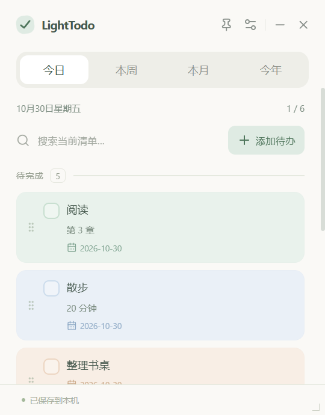
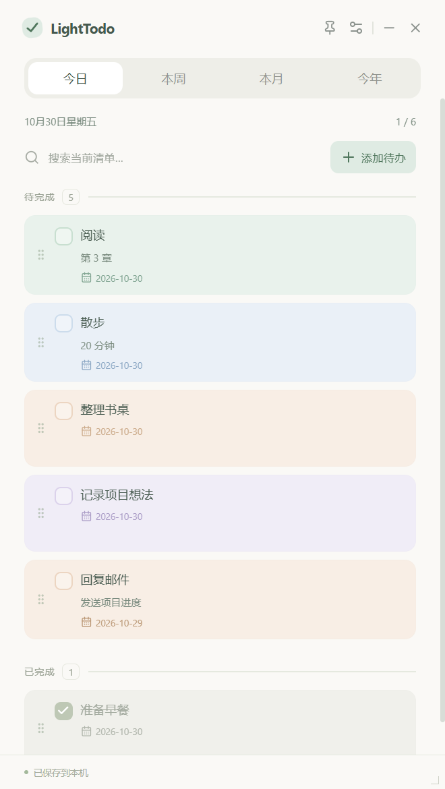
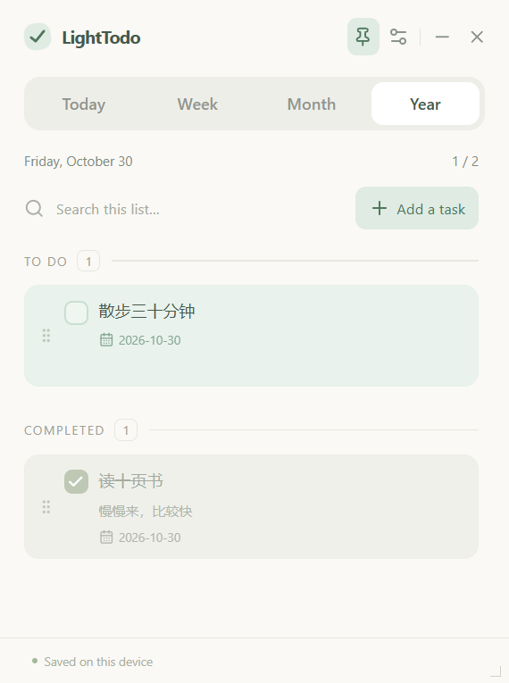
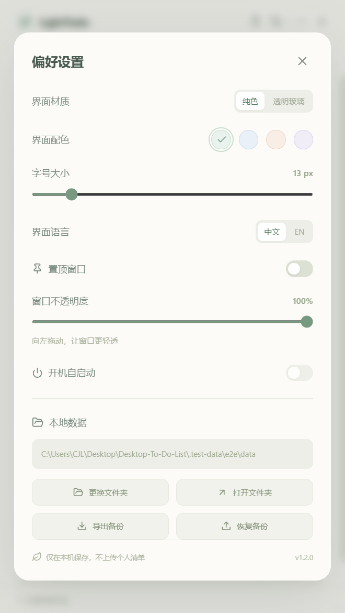
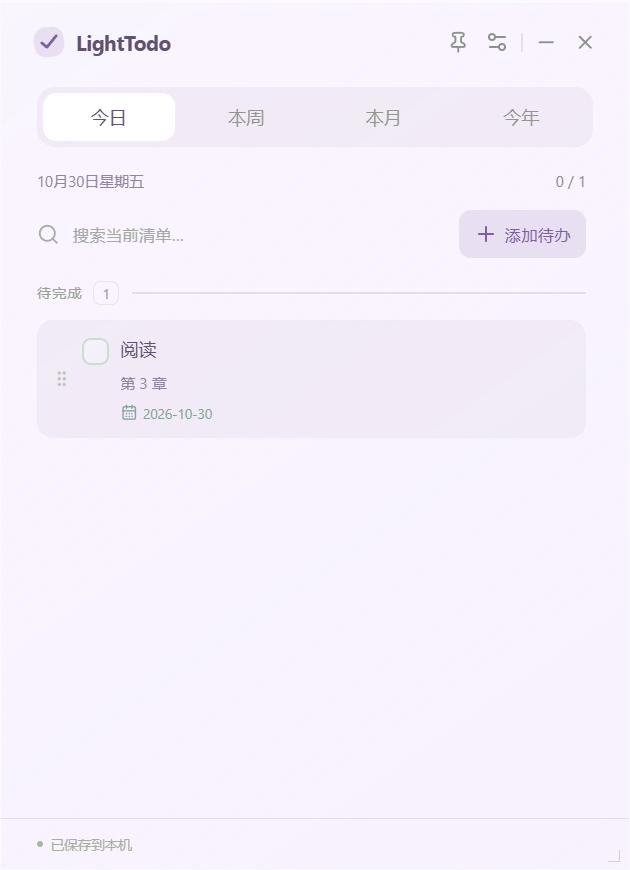

# LightTodo

[简体中文](README.md) | **English**

A minimal desktop todo list with pastel colors and local storage, for Windows and macOS.

[Download installers](https://github.com/JLChennn/LightTodo/releases/latest) · [Report an issue](https://github.com/JLChennn/LightTodo/issues) · [Verification record (Chinese)](docs/VERIFICATION.md) · [MIT license](LICENSE)

## UI preview

The default compact window (360 × 460) opens at the top-left of the primary display:



Expanded list, English interface, and preferences:

  

Task titles are user content and are not translated when switching the interface language.

Glass material example (Lavender):



## Get started without coding

You do not need Node.js, Python, developer tools, or a GitHub account to use the app.

### Install on Windows

1. Open **Download installers** above and find **Assets** on the release page.
2. Download the `.exe` file, such as `LightTodo-1.2.1-win-x64.exe`. Do not download **Source code** unless you want to develop the app.
3. Double-click the installer. On **Choose Install Location**, select **Browse** to choose another drive or folder, such as `D:\Apps\LightTodo`, then select **Install**. The setup wizard lets you choose the installation directory. Changing that directory does not move your personal task data.
4. Open **LightTodo** using its desktop shortcut.

The Windows installer targets x64. Running it on Windows ARM depends on your system's x64 emulation and has not been verified.

**This build is unsigned.** Windows may display “Windows protected your PC.” Confirm that the file came from this repository's Releases page before using **More info → Run anyway**, if your system offers it. Organization-managed computers may block this option. You do not need to disable antivirus software.

### Install on Mac

1. Download the `.dmg` file from the same release page.
2. Open it and drag **LightTodo** to **Applications**, or use Finder to copy it to a folder of your choice, such as `~/Applications`. Do not keep running the app directly from the mounted DMG.
3. Open LightTodo from the folder you chose. If you move the app after enabling launch at login, turn that option off and on again to update its path.

macOS uses `.dmg`, not `.exe`. The Universal installer includes both Apple silicon and Intel architectures.

**The Mac build has no Apple Developer ID signature or notarization and has not received manual installation testing on a physical Mac.** It uses ad-hoc signing and has passed automated interaction tests on a hosted macOS runner. Gatekeeper may block the first launch. After confirming the source, check **System Settings → Privacy & Security** for **Open Anyway**, if available. Do not disable system security protections. Hosted tests are distinct from manual testing on your own Mac.

## First launch

The app opens on **Today**, with Chinese as the default interface language. Select the gear icon at the top-right, then **EN**, to switch to English. Select **中文** to switch back.

Each launch starts with a minimum-size window of approximately **360 × 460**, positioned 16 logical pixels from the top-left of the primary display's usable area. Windows display scaling can slightly affect the outer frame dimensions. You can move and resize the window after launch.

Window behavior matches version 1.1.0: LightTodo opens as an ordinary window. Select the pin icon to keep it above other windows; select it again to return to normal window behavior. Windows shows its taskbar button, and minimizing or using Show Desktop follows normal system behavior.

Select **Add a task** to begin. Data is saved locally by default. To choose another folder, open **Preferences → Change folder**.

The installation directory and the data folder are separate. You do not need to edit the data files manually.

## Everyday use

| What you want to do | How to do it |
| --- | --- |
| Add a task | Select **+ Add a task**, enter a title, optionally add notes, a planned date, and a card color, then select **Add to list** |
| Edit a task | Select its text, or hover over the card and select the pencil icon |
| Complete a task | Select the checkbox; the task turns gray, receives a strikethrough, and moves below unfinished tasks |
| Mark a task incomplete | Select its checked checkbox again |
| Delete a task | Hover over the card, select the trash icon, and confirm |
| Reorder tasks | Drag the grip handle on the left, or hover over a card and use the up/down arrows; the order is saved automatically |
| Search | Search titles or notes within the current date range; switch to **Year** to search the current year |
| Switch date range | Use **Today / Week / Month / Year** at the top |
| Keep the window on top | Select the pin icon; select it again to unpin. System security screens and some fullscreen windows may still cover it |
| Resize | Drag a window edge or corner; the minimum size is 360 × 460 |
| Move the window | Drag an empty area of the title bar near the LightTodo name |
| Scroll | Use a mouse wheel, trackpad, or the scrollbar; the preferences dialog also scrolls |
| Adjust font size | Preferences → Font size, 12–20 px; scales list and preferences text |
| Change interface color | Preferences → Interface color: Mint, Blue, Peach, or Lavender; individual task colors remain independent |
| Glass material | Preferences → Material → Glass; works with every interface color. Select Solid to restore an opaque background |
| Adjust opacity | Open Preferences and drag **Window opacity**, from 35% to 100% |
| Switch language | Open Preferences and select **EN** or **中文** |
| Launch at login | Enable **Launch at login** in Preferences. It is off by default; disabling it removes the startup entry |

Keyboard shortcuts: **Ctrl+N / ⌘N** adds a task; **Esc** closes a dialog; **Tab / Shift+Tab** moves between controls.

### How date ranges and ordering work

- Each task has a planned date, defaulting to today. You can select a past or future date.
- **Today** includes today's tasks and all unfinished overdue tasks.
- **Week** runs from Monday through Sunday, including weeks that cross month or year boundaries.
- **Month / Year** use the current calendar month or year according to your computer's date.
- Overdue tasks keep their original planned dates. Once completed, they appear in the range containing that date. Tasks from previous years remain in the local JSON file; this version has no navigation for historical years.
- Unfinished tasks always appear above completed tasks. You can reorder within either group, but cannot drag across completion states. Overdue dates use a different color rather than a separate forced group.
- The order is saved globally and reused across date ranges and searches. Reordering filtered results only changes visible tasks; hidden tasks retain their relative positions. Completing a task moves it to the completed group; marking it incomplete restores its position within the unfinished group.
- The count beside the date shows **completed tasks / total matching tasks**.
- Restarting returns to **Today** and the compact top-left window. Language, pinning, opacity, font size, color, and material preferences are remembered.

### Pinning and glass material

Pin the list to display above other applications; unpin to restore ordinary window behavior. Use the taskbar or Dock to switch to it. Pinning is remembered across restarts. Closing the app exits it; enable Launch at login to open it automatically when signing in.

Glass uses native Vibrancy on macOS and Acrylic on Windows 11 22H2 or later. System version, Reduce Transparency accessibility settings, and remote desktop sessions can affect background blur. When native blur is unavailable, the app retains a translucent tinted glass background. Glass keeps text separate from the background transparency; Window opacity affects the entire window, so start with 100% when using Glass.

### About launch at login

Launch at login is available in the **packaged application**. Its switch is disabled in source development mode so the Electron development binary is not registered as a startup application.

- **Windows:** registers `LightTodo.exe` from the current installation directory for the current user. Custom paths containing spaces are supported. Disable it in Preferences to remove the entry. A normal uninstall also removes it; upgrades preserve the existing entry.
- **macOS:** creates `~/Library/LaunchAgents/io.github.jlchennn.lighttodo.plist` for the current user. Disabling the option removes that file. If macOS asks whether to allow a background item, decide whether to allow it yourself. Disable this option before deleting the Mac app.
- “Launch at login” means opening the app after the user signs in, not running a service before login. Registration, status reading, and removal have been tested; an actual reboot or logout/login cycle has not been verified.

## Data storage and backups

**Preferences → Local data** shows the actual data folder. Select **Open folder** to view it.

Default locations:

| System | Default data folder |
| --- | --- |
| Windows | `%APPDATA%\LightTodo\data` |
| macOS | `~/Library/Application Support/LightTodo/data` |

The path displayed in Preferences is authoritative.

- `lighttodo.json`: your current list.
- `lighttodo.json.bak`: the list before the most recent successful write, maintained automatically. **This is not a permanent history.**
- `lighttodo.pre-restore-<timestamp>.json`: a separate copy saved before restoring a backup.
- `lighttodo.json.corrupt-<timestamp>`: the original damaged file, preserved when recovering from an automatic backup.
- `settings.json`: application preferences in the system application-data directory. Changing the task data folder does not move this settings file.

### Export a backup

Open **Preferences → Export backup** and save the `.json` file somewhere else. Regularly copying a backup to another drive is recommended.

### Restore a backup

Open **Preferences → Restore backup**, select a previously exported JSON file, and confirm. **Restore replaces the current list; it does not merge lists.** A separate pre-restore copy is saved first.

### Change the data folder

Open **Preferences → Change folder**. If the destination has no LightTodo list, the app copies your current list there and leaves the original files in place. If it already contains a list, the app asks whether to switch to that list; it does not automatically overwrite or merge it. Future launches use the new location.

Changes save automatically. Wait for **Saved on this device** before shutting down. If saving fails, check disk space and folder permissions, then select **Retry**. Do not edit the active JSON file with another program or write to the same synced folder from two computers at once. This version does not provide multi-device synchronization or concurrent file merging.

## Updating and uninstalling

- **Update:** export a backup, quit LightTodo, and install the new version. There is no automatic updater.
- **Uninstall:** on Windows, use **Settings → Apps**; on Mac, move the app to the Trash. The app does not intentionally delete your task data during uninstall.
- **Remove data completely:** export anything you need, note the data folder shown in Preferences, quit the app, and manage those files yourself. A custom data folder is not automatically removed during uninstall.

## Frequently asked questions

**Will closing the app lose my list?** Saved tasks remain after restart. The top-right × quits the app rather than minimizing it to a tray. Use − to minimize it.

**Why is a task completed yesterday missing from Today?** It remains under its planned date. Use **Week / Month / Year** to find it when that range includes the date.

**Why did my list change after switching folders?** The destination already contained another list. Switch back to the original folder to see your previous list.

**Why does the text fade when I lower opacity?** Opacity applies to the entire window, including text. Restore it to 100% for full opacity.

**I disconnected a display and cannot find the window.** Quit and reopen the app. It starts at the top-left of the current primary display.

**My disk or folder is unavailable.** Reconnect the disk or restore access before opening the app again. It will not silently replace a configured missing list with a new empty one just to keep running.

**Are my tasks uploaded to GitHub?** No. The public repository contains code, demo screenshots, and installers. The app has no account system, telemetry, or cloud task service and works offline.

## For developers

Stack: Electron, React, TypeScript, Vite, and electron-builder. Install **Node.js 24 LTS** and Git. Python is only needed if you choose to regenerate the icons; it is not required to run or package the app.

```bash
git clone https://github.com/JLChennn/LightTodo.git
cd LightTodo
npm ci
npm start
```

`npm ci` downloads the Electron runtime, so keep your connection available. The project explicitly runs Electron's runtime installation step for versions that no longer download it automatically.

```bash
npm test             # Date boundaries, validation, storage, recovery, and startup adapters
npm run test:e2e     # Interaction tests in a real Electron window
npm run dist:win     # Build the Windows x64 installer on Windows
npm run dist:mac     # Build the Universal DMG on macOS
```

Installers are written to `release/`, which is excluded from Git. Build the Mac package on macOS; renaming a Windows build does not produce a Mac app.

`npm run dev` starts the frontend development server only. Native features require the Electron environment started by `npm start`. There is no browser mock-data mode.

Project structure:

```text
electron/       Desktop window, restricted IPC, local storage, and startup integration
src/            React interface, translations, filtering, and ordering
tests/          Logic tests and real Electron interaction tests
build/          App icons and installer customization
docs/           Actual UI screenshots and verification records
.github/        Automated checks and cross-platform packaging
```

Tests use a separate `.test-data/` folder rather than your everyday list. Only development builds accept `LIGHTTODO_TEST_HOME` to override the test data location; packaged applications ignore it.

### Clone locally and customize with AI

LightTodo is MIT-licensed. You can clone it locally, modify it, extend its features, and build your own installers. Open the cloned folder in an AI coding tool such as Codex or Cursor, then describe the changes you want in natural language.

For example:

> Please read this project's README first. I want to add task priorities to LightTodo while preserving its minimal design, Chinese/English interface, and compatibility with existing local data. Explain the plan first, then implement it, add the necessary tests, and show me how to package an installer.

Start with the `git clone` command above, open the cloned `LightTodo` folder in your AI tool, and ask it to make the changes. Run `npm test` and `npm run test:e2e`, then package the app on the appropriate operating system. Export a task backup before changing the app. Use the UI screenshots in this README as a design reference.

Possible DIY ideas include tags, priorities, reminders, recurring tasks, and theme colors. These are extension ideas, not features already included in the current version.

### Release workflow

1. Update the version in `package.json` and the lockfile, then finish testing.
2. Create a draft GitHub Release for the version, such as `v1.1.0`, explaining signing and verification limitations.
3. Push the matching tag to trigger **Build and release**. Windows and macOS runners package and upload their installers separately.
4. Check both jobs and the downloadable files before announcing the release. Manually dispatching the workflow generates Actions artifacts without automatically creating a release.

Keep signing credentials out of the source code. If signing is added later, configure it through GitHub Secrets. Current releases do not have trusted developer signatures.

## License

[MIT](LICENSE) © 2026 JLChennn
