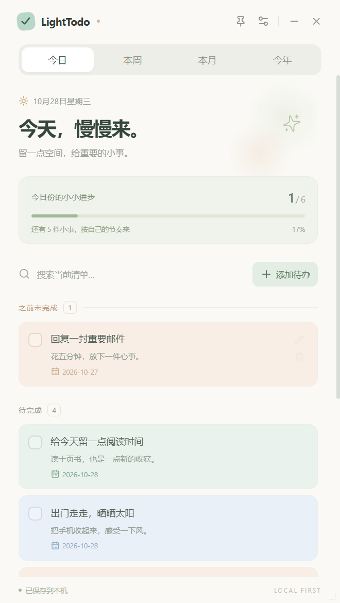

# LightTodo

**轻一点，做得到。** 一个清爽、安静的桌面待办清单，使用马卡龙配色，数据留在自己的电脑里。

[下载安装包](https://github.com/JLChennn/LightTodo/releases/latest) · [反馈问题](https://github.com/JLChennn/LightTodo/issues) · [MIT 许可证](LICENSE)



## 我只想使用，不会编程

你不需要安装 Node.js、Python 或任何开发工具，也不需要登录 GitHub。

### Windows 安装

1. 打开上面的「下载安装包」链接，找到版本页面的 **Assets（资源）**。
2. 下载以 `.exe` 结尾的文件，例如 `LightTodo-1.0.0-win-x64.exe`。不要下载 `Source code`，那是给开发者看的源码。
3. 双击安装包，选择安装位置，按向导完成安装。
4. 双击桌面上的 **LightTodo** 图标，就可以开始使用。

目前提供 Windows x64 安装包。ARM Windows 是否可用取决于系统的 x64 模拟能力，尚未验收。

**这是未签名版本。** Windows 可能显示「Windows 已保护你的电脑」。请先确认文件来自本仓库 Releases，再按系统提供的「更多信息 → 仍要运行」继续；组织管理的电脑可能不允许这样操作。无需关闭杀毒软件。

### Mac 安装

1. 在同一个下载页面，下载以 `.dmg` 结尾的文件。
2. 双击打开，将 **LightTodo** 拖到 **Applications（应用程序）** 文件夹。
3. 从「应用程序」中打开 LightTodo。

macOS 使用 `.dmg`，不使用 `.exe`。提供 Universal 安装包，同时包含 Apple 芯片和 Intel 架构。

**Mac 版本未使用 Apple 开发者证书签名，也未公证，且尚未进行 Mac 真机验收。** 首次打开可能被 Gatekeeper 拦截。确认来源后，可按系统提示前往「系统设置 → 隐私与安全性」查看是否提供「仍要打开」。不需要关闭系统安全保护。构建成功只表示安装包生成，不等同于真机运行验证。

## 第一次打开

默认打开「今日」，界面语言为中文。欢迎卡片会显示数据保存位置：

- 直接点「开始记录」，使用默认文件夹；
- 或点「更换文件夹」，选择你熟悉的位置，例如 `文档/LightTodo数据`。

安装目录和数据目录是两回事。日常无需手动编辑数据文件。

## 每天怎么用

| 想做的事 | 操作 |
| --- | --- |
| 新增待办 | 点「＋ 添加待办」，输入标题，按需填写备注、日期和卡片颜色，再点「加入清单」 |
| 修改待办 | 点任务文字，或将鼠标移到卡片上后点铅笔图标 |
| 完成待办 | 点左边方框；任务变灰、加删除线，并移到未完成任务下面 |
| 恢复为未完成 | 再点一次已勾选的方框 |
| 删除待办 | 将鼠标移到卡片上，点垃圾桶图标，再确认删除 |
| 查找待办 | 输入搜索词，匹配当前时间范围内的标题或备注；查全年可切到「今年」 |
| 切换时间范围 | 顶部点「今日 / 本周 / 本月 / 今年」 |
| 固定在其他窗口上面 | 点右上角图钉；再次点击取消。系统安全界面、部分全屏窗口可能仍覆盖它 |
| 调整窗口大小 | 拖动窗口边缘或四角，最小尺寸为 360 × 460 |
| 移动窗口 | 拖动顶部 LightTodo 标题附近的空白处 |
| 上下滚动 | 鼠标滚轮、触控板或右侧滚动条；设置弹窗也可滚动 |
| 调整透明度 | 点右上角设置图标，拖动「窗口不透明度」，范围为 35%–100% |
| 改为英文 | 设置 → 界面语言 → EN；点「中文」切回 |

快捷键：**Ctrl+N / ⌘N** 新增待办；**Esc** 关闭弹窗；**Tab / Shift+Tab** 切换控件。

### 今日、本周等是怎么区分的？

- 每条任务有一个「计划日期」，新增时默认今天，也可改成未来或过去。
- 今日：今天的任务，加上所有「之前未完成」的任务。
- 本周：周一到周日，包括跨月、跨年的一周。
- 本月 / 今年：按本机日期对应的自然月 / 自然年筛选。
- 之前未完成的任务不会自动改日期；完成后回到它原计划日期所属的范围。要查往年的任务，可以恢复到对应日期的备份或查看本地 JSON；当前版本没有历史年份导航。
- 每个范围内，所有未完成任务都在已完成任务上方；组内按计划日期、创建时间排序。
- 进度按当前范围及搜索结果计算，文字里的任务数会随筛选变化。
- 重启默认回到「今日」，语言、置顶、透明度、窗口大小和位置会记住。

## 数据在哪里？怎么备份？

**设置 → 本地数据** 显示真实保存路径，点「打开文件夹」即可查看。

默认位置：

| 系统 | 默认数据目录 |
| --- | --- |
| Windows | `%APPDATA%\LightTodo\data` |
| macOS | `~/Library/Application Support/LightTodo/data` |

实际路径以设置面板显示为准。

- `lighttodo.json`：当前清单。
- `lighttodo.json.bak`：上一次成功写入前的清单，自动维护，**不等于永久历史记录**。
- `lighttodo.pre-restore-时间戳.json`：恢复备份前保留的独立副本。
- `lighttodo.json.corrupt-时间戳`：遇到损坏文件并从备份恢复时保留的原文件。
- 应用设置在系统应用数据目录的 `settings.json`，更换清单目录不会移动它。

### 手动备份

设置 →「导出备份」→ 选一个其他位置保存 `.json` 文件。建议定期复制到另一块硬盘。

### 恢复备份

设置 →「恢复备份」→ 选之前导出的 JSON → 确认。**恢复会替换当前清单，不会合并**；应用会另外保留恢复前副本。

### 更换保存位置

设置 →「更换文件夹」。目标文件夹为空时，复制当前清单过去，原目录文件保留；如果目标文件夹已有 LightTodo 清单，会先询问是否切换到该清单，不会自动覆盖或合并。以后启动使用新位置。

应用会自动保存。底部显示「已保存到本机」后再关机更稳妥。若显示「保存失败」，请检查磁盘空间、目录权限，点「重试」。不要同时用其他程序编辑正在使用的 JSON，也不要在两台电脑上同时写同一个同步盘目录。当前版本没有多设备同步或多进程文件合并。

## 更新与卸载

- 更新：先导出备份，退出 LightTodo，再安装新版。没有自动更新功能。
- 卸载：Windows 从「设置 → 应用」卸载；Mac 将应用移到废纸篓。应用默认不主动删除你的清单数据。
- 想完全删除数据：先导出需要的内容，记录设置里显示的数据目录，退出应用后再自行处理。自选文件夹不会随卸载自动清除。

## 常见问题

**关闭后清单会不会丢？** 正常保存后重启仍在。右上角 × 会退出应用，不是最小化到托盘；需要暂时收起请点 −。

**为什么今天看不到昨天已经完成的任务？** 它仍保存在原日期，切换「本周 / 本月 / 今年」查看。

**换目录后清单不同了？** 目标目录已有清单时，选择的是那一份。切回原目录就能看到旧清单。

**透明后文字也淡了？** 这是整个窗口的不透明度，包含文字。调回 100% 即可。

**外接显示器拔掉后找不到窗口？** 重启时会检测位置是否在可用屏幕内；不在时回到默认位置。

**磁盘或文件夹暂时不可用？** 重新接入磁盘或恢复访问权限后再启动。应用不会为了继续运行而悄悄新建另一份清单覆盖原数据。

**会把我的待办上传 GitHub 吗？** 不会。公开仓库只保存程序源码、演示截图和安装包。程序不接入账号、遥测或云端待办服务，使用不依赖联网。

## 给想修改代码的人

技术栈：Electron、React、TypeScript、Vite、electron-builder。需要 **Node.js 24 LTS** 和 Git。Python 只用于可选的图标重新生成，不影响运行和打包。

```bash
git clone https://github.com/JLChennn/LightTodo.git
cd LightTodo
npm ci
npm start
```

`npm ci` 会下载 Electron 运行时，请保持网络畅通。项目明确运行 Electron 安装步骤，适配其不再自动下载运行时的版本。

```bash
npm test             # 日期边界、数据校验、文件保存与恢复
npm run test:e2e     # 启动真实 Electron 窗口进行交互验证
npm run dist:win     # 在 Windows 构建 x64 exe
npm run dist:mac     # 在 macOS 构建 Universal dmg
```

安装包输出到 `release/`，该目录不会提交 Git。macOS 需要 macOS 环境构建，不能把 Windows 构建结果改扩展名当成 Mac 包。

`npm run dev` 只启动前端开发服务器；原生能力需要 `npm start` 启动的 Electron 环境。当前未提供浏览器模拟数据模式。

源码结构：

```text
electron/       桌面窗口、受限 IPC、本地文件存储
src/            React 界面、语言文案、日期筛选
tests/          逻辑测试及真实 Electron 交互测试
build/          应用图标
docs/           实际界面截图、验证记录
.github/        自动检查及双平台打包流水线
```

测试使用独立的 `.test-data/`，不会读取或修改日常清单。仅开发模式接受 `LIGHTTODO_TEST_HOME` 覆盖测试数据位置，安装后的应用忽略它。

### 发布流程

1. 更新 `package.json` 版本和锁定文件，完成测试。
2. 先创建对应版本的 GitHub Release，例如 `v1.0.0`，写清未签名和验证边界。
3. 推送同名标签，触发 `Build and release`；Windows 和 macOS runner 分别打包并上传安装包。
4. 检查两个构建任务及下载文件后再宣布交付。手动运行流水线只生成 Actions artifacts，不自动创建发布。

证书不写进源码。未来如加入签名，使用 GitHub Secrets 配置。当前发布明确为未签名版本。

## English

LightTodo is a minimal, local-first desktop todo list for Windows and macOS. Download the installer from [Releases](https://github.com/JLChennn/LightTodo/releases/latest): `.exe` for Windows x64 or Universal `.dmg` for macOS. No developer tools or account are required to use it. Both builds are unsigned; macOS is not notarized and has not been verified on a physical Mac.

Use Preferences → **EN** to switch language. Create, edit, search and complete tasks; completed items move below unfinished ones. Tasks are filtered by planned date. Today also includes unfinished overdue tasks. Weeks start on Monday. Pin the window, resize it, adjust opacity, and choose your local data folder in Preferences. Export JSON backups regularly. Restore replaces the current list after confirmation and creates a separate pre-restore backup. Your personal list is never uploaded to GitHub.

## License

[MIT](LICENSE) © 2026 JLChennn
